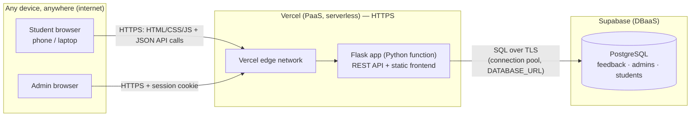
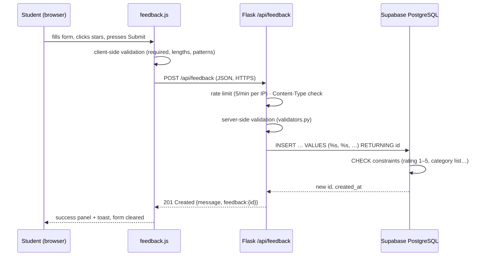

# Architecture, Cloud Concepts and Data Flow

This document explains **how the system works** and **why it is built this way**, in plain language. Read it alongside the code: every section points to the files involved.

---

## 1. The big picture



The same picture as plain text (for slides and viva):

```
┌─────────────────┐   HTTPS (JSON)    ┌───────────────────────────┐   SQL over TLS   ┌──────────────────────┐
│  Browser        │ ────────────────▶ │  Vercel (serverless)      │ ───────────────▶ │  Supabase            │
│  (presentation) │ ◀──────────────── │  Flask function           │ ◀─────────────── │  PostgreSQL          │
│  HTML/CSS/JS    │   JSON responses  │  (application/logic tier) │   rows           │  (data tier)         │
└─────────────────┘                   └───────────────────────────┘                  └──────────────────────┘
   Bootstrap, Chart.js                  validation, auth, queries,                     tables, constraints,
                                        rate limiting, CSV export                      indexes, RLS
```

This is a classic **three-tier architecture**:

| Tier | Technology | Responsibility | Folder |
|---|---|---|---|
| Presentation | HTML5, CSS3, Bootstrap 5, JavaScript, Chart.js | What the user sees; basic validation; calls the API | `frontend/` |
| Application | Python, Flask (Vercel serverless function) | Business rules: validation, authentication, authorisation, building SQL, aggregations | `backend/` |
| Data | Supabase PostgreSQL | Durable storage, constraints, indexes | `database/schema.sql` |

**Why separate tiers?** Each can change or scale independently. The browser never talks to the database directly, so the database password never leaves the server.

### Why each technology was chosen

| Technology | Why |
|---|---|
| **Flask** | Small, readable Python web framework. Ideal for REST APIs, and every line is understandable for a student project. |
| **psycopg2** | The standard PostgreSQL driver for Python. Supports parameterised queries (SQL-injection safe) and connection pooling. |
| **Supabase** | Fully managed PostgreSQL with a free tier: backups, TLS and a web dashboard included, with no server to maintain. |
| **Vercel** | Hosts both the frontend and the Flask backend from one project. Deploys straight from GitHub, provides HTTPS and a global edge network automatically, and its free tier needs no Docker or server setup. |
| **Bootstrap 5** | Responsive grid and ready-made components (navbar, modal, toast), so we focus on the logic. |
| **Chart.js** | Simple canvas charts with tooltips and responsive resizing. |
| **Flask-Limiter** | Rate limiting with a decorator per route. |

---

## 2. Cloud computing concepts used

| Concept | Where it appears in this project |
|---|---|
| **IaaS / PaaS / SaaS** | Vercel is **PaaS** (serverless): we push code, and Vercel handles servers, OS, scaling, networking and TLS. Supabase is **DBaaS** (a kind of PaaS): a managed database. GitHub is SaaS. We never manage a virtual machine (that would be IaaS, e.g. AWS EC2). |
| **Managed database (DBaaS)** | Supabase runs PostgreSQL for us, including patching, backups and availability. We only design tables. |
| **Public cloud & multi-tenancy** | Both providers run many customers on shared hardware, isolated from each other. That is why the free tier is possible. |
| **Remote accessibility / ubiquitous access** | The app has a public HTTPS URL, so any device with internet access can use it. Tested on desktop and a 390 px phone viewport. |
| **On-demand self-service** | We created the database and web service ourselves from a dashboard in minutes, without contacting anyone. |
| **Elasticity / scaling** | Vercel automatically starts more function instances as traffic grows, and Supabase can upgrade compute, without code changes. This works because the app is **stateless**: sessions live in signed cookies, not server memory. (Rate-limit counters are the exception. See the limitations below.) |
| **Measured service / pay-as-you-go** | Both bill by usage tier: function invocations and duration, DB size, egress. We stay within free quotas. |
| **Configuration via environment variables (12-factor app)** | `DATABASE_URL`, `SECRET_KEY` and others are read from the environment (`backend/config.py`). The same code runs locally and in the cloud with different settings, and secrets never go into Git. |
| **Continuous deployment** | Vercel's GitHub integration: each `git push` to `main` triggers a build and a zero-downtime production deploy; other branches get preview URLs. |
| **Health checks** | `/api/health` returns 200 only if the app can reach the database; we call it after every deploy (`verify_deployment.py`). |
| **Scale-to-zero / serverless** | Vercel runs Flask as a function that only runs when a request arrives: you pay (or use quota) only when used. |
| **Security in the cloud** | TLS everywhere (browser→Vercel and Vercel→Supabase), secrets in env vars, Row Level Security on Supabase, least exposure (the DB is never reachable from the browser). |
| **Connection pooling** | Two levels: our app keeps a small `ThreadedConnectionPool` (`backend/database.py`), and Supabase's **Supavisor** pooler multiplexes connections from many clients. |

---

## 3. The request–response cycle (one HTTP request, step by step)

Example: the admin opens the Feedback tab, which sends
`GET /api/feedback?page=1&per_page=10&category=Library`.

1. **Browser**: `dashboard.js` calls `API.get(...)` in `api.js`, which runs `fetch()` with `credentials: "include"` so the session cookie is sent.
2. **DNS + TLS**: the browser resolves `campusvoice.vercel.app` and opens an encrypted HTTPS connection to Vercel's edge network.
3. **Vercel edge → Flask function**: `vercel.json` rewrites the request to `api/index.py`, and Vercel invokes our Flask app in a serverless function (starting one if none is warm). `ProxyFix` restores the real client IP and `https` scheme.
4. **Flask routing**: the URL matches `list_feedback()` in `routes/feedback.py`.
5. **Authentication**: the `@admin_required` decorator checks `session["admin_id"]`. Flask has already verified the cookie's HMAC signature with `SECRET_KEY`. Missing or forged cookie → **401** immediately.
6. **Validation**: `parse_filters()` and `parse_paging()` whitelist every query parameter. Bad input → **400** with field messages.
7. **Database**: `models/feedback.py` borrows a connection from the pool and runs two parameterised queries over TLS to Supabase: `COUNT(*)` for pagination and `SELECT … LIMIT 10 OFFSET 0`.
8. **PostgreSQL** uses `idx_feedback_category` to find rows and returns them.
9. **Serialization**: rows (Python dicts) become JSON. Datetimes become ISO-8601 strings.
10. **Response**: Flask adds security headers (`Cache-Control: no-store`, `X-Content-Type-Options`, …) and returns **200** with JSON.
11. **Browser**: `renderRows()` builds the table. All student text is passed through `UI.esc()` so stored text can never run as HTML or script (XSS protection).

---

## 4. Data flow: from the student form to the cloud database



Points to note:

* Validation happens **three times**: in the browser (fast feedback), in Flask (security, since a browser can be bypassed with curl or Postman), and in PostgreSQL `CHECK` constraints (last line of defence against bad data from any source).
* If a **student is logged in**, the server takes their name and ID from the **session**, not from the form. A student therefore cannot file feedback under someone else's ID, and the row is linked through `student_account_id` for the *My Submissions* page.
* `created_at` is set by the database (`DEFAULT NOW()`), so timestamps cannot be faked by the client.

## 5. How the admin retrieves feedback

1. **Login** (`login.html` → `POST /api/admin/login`). Flask looks up the admin by username and runs `check_password_hash()` (scrypt) on the password. On success it stores `admin_id` in the session, and Flask sends a **signed, HttpOnly, Secure, SameSite=Lax** cookie.
2. **Dashboard load** (`dashboard.html`). `GET /api/session` confirms the login. Then `GET /api/admin/dashboard` returns the overview numbers, computed **inside PostgreSQL** with `COUNT`, `AVG` and `COUNT … FILTER`. Only the results travel over the network.
3. **Feedback table**: `GET /api/feedback` with search, filter, sort and pagination parameters (section 3).
4. **Detail**: `GET /api/feedback/<id>`.
5. **Analytics**: `GET /api/feedback/analytics` returns four datasets (`GROUP BY category`, `GROUP BY rating`, and a daily trend built with `generate_series` + `LEFT JOIN`, so days with zero feedback still appear). Chart.js draws them.
6. **Reports**: `GET /api/feedback/export` streams a CSV. `report.html` pages through `/api/feedback` and lays the result out for printing.
7. **Logout**: `POST /api/admin/logout` removes the admin keys from the session.

---

## 6. Database design

```
students                          feedback                                   admins
────────────────────────          ────────────────────────────────────       ────────────────────────
id            SERIAL PK   ◀───┐   id                  SERIAL PK              id            SERIAL PK
student_id    VARCHAR(20) UQ  │   student_name        VARCHAR(100)           username      VARCHAR(50) UQ
full_name     VARCHAR(100)    │   student_id          VARCHAR(20)  [idx]     password_hash TEXT
department    VARCHAR(80)     │   department          VARCHAR(80)            created_at    TIMESTAMPTZ
password_hash TEXT            │   semester            SMALLINT  CHECK 1–8
created_at    TIMESTAMPTZ     │   category            VARCHAR(40) CHECK IN (…6) [idx]
                              │   rating              SMALLINT  CHECK 1–5    [idx]
                              │   description         TEXT      CHECK 10–2000 chars
                              │   suggestions         TEXT NULL CHECK ≤1000
                              └── student_account_id  INT NULL FK → students.id (ON DELETE SET NULL) [idx]
                                  created_at          TIMESTAMPTZ DEFAULT NOW()  [idx DESC]
```

* **Why `student_id` is copied into `feedback`** even when an account exists: most students submit without an account, and the admin table needs the ID either way. `student_account_id` is only the link for the history page.
* **Indexes** match the dashboard's queries: newest first (`created_at DESC`), category filter, rating filter, student ID search, history lookup.
* **TIMESTAMPTZ** stores an absolute instant (UTC internally), so times are correct whatever time zone the viewer is in.
* **Not normalised into a `categories` table**: the six categories are fixed by the project brief, so a `CHECK` constraint is simpler. Making categories admin-editable would be the time to add a table (see Future enhancements in the README).

---

## 7. Security model

| Threat | Defence | Code |
|---|---|---|
| SQL injection | Parameterised queries everywhere. Sort column taken from a whitelist and quoted with `psycopg2.sql.Identifier` | `models/*.py` |
| Stolen database ⇒ passwords | scrypt hashes with per-password salt (`werkzeug.security`) | `models/users.py` |
| Username enumeration | Same error message, and a dummy hash check so timing is equal | `models/users.py` |
| Session forgery / tampering | Cookie signed with `SECRET_KEY` (HMAC). Tampering → treated as logged out | Flask sessions |
| Session theft via XSS | `HttpOnly` cookie, all output escaped (`UI.esc`), Content-Security-Policy | `common.js`, `app.py` |
| Session fixation | `session.clear()` on admin login | `utils/auth.py` |
| CSRF | `SameSite=Lax` cookie, plus all state-changing endpoints require `Content-Type: application/json` (not sendable cross-site without a CORS pre-flight) | `utils/auth.py` |
| Brute-force login / spam | Flask-Limiter: 5/min on admin login and submissions | `routes/*.py` |
| Clickjacking | `X-Frame-Options: DENY`, `frame-ancestors 'none'` | `app.py` |
| Data exposure via Supabase REST API | Row Level Security enabled + `REVOKE` from `anon`/`authenticated` | `schema.sql` |
| Secrets in Git | `.env` in `.gitignore`. Production secrets live in Vercel environment variables | `.gitignore`, `config.py` |
| CSV / formula injection | Cells starting with `= + - @` are prefixed with `'` | `routes/feedback.py` |
| Huge payloads | `MAX_CONTENT_LENGTH = 64 KB`, field length limits | `config.py` |
| Student privacy | Every endpoint that returns student data requires admin login. Students see only their own rows | `routes/` |

### Known limitations (be honest in the viva)

* **Rate-limit counters are kept in memory** of each function instance. Vercel may run several instances, and each counts separately, so the limit is approximate. For strict limits point `RATELIMIT_STORAGE_URI` at Redis (e.g. Upstash).
* **Logout cannot revoke a stolen cookie** before it expires (signed-cookie sessions are stateless). A server-side session table would allow revocation. Lifetime is limited to 120 minutes.
* **Serverless cold starts** (~1–3 s) on the first request after the function was idle.
* **Search uses `ILIKE '%term%'`**, which cannot use a normal B-tree index. That is fine for thousands of rows. At larger scale add a `pg_trgm` GIN index.
